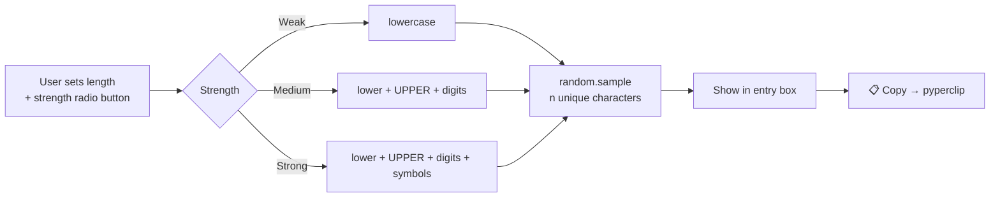
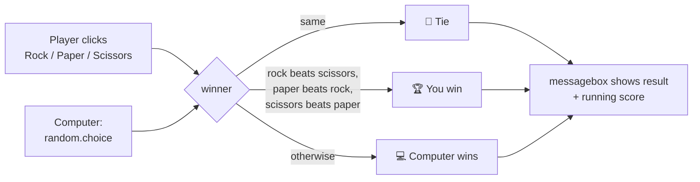
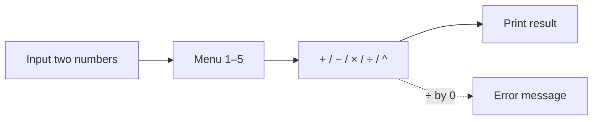

<div align="center">

# 🐍 CodSoft Python Internship Projects

**Three small Python apps from the CodSoft Python Programming internship:**
a password generator, Rock‑Paper‑Scissors and a calculator.


</div>

---

## 📦 What's Inside

| # | Project | File | Interface | Highlights |
|:-:|--------|------|:---------:|-----------|
| 1 | 🔐 **Password Generator** | [`PasswordGeneraator.py`](PasswordGeneraator.py) | Tkinter GUI | Choose a length (5–18) and strength level (weak / medium / strong) and copy the password to the clipboard with `pyperclip` |
| 2 | ✊ **Rock · Paper · Scissors** | [`Rock_Paper_Scissors.py`](Rock_Paper_Scissors.py) | Tkinter GUI | Play against the computer, which picks at random. A running scoreboard counts the wins and has a reset button |
| 3 | 🧮 **Simple Calculator** | [`calculator.py`](calculator.py) | Command line | Add, subtract, multiply, divide (guards against division by zero) and raise to a power |

## 🔍 How Each One Works

### 🔐 Password Generator



### ✊ Rock · Paper · Scissors



### 🧮 Calculator



## 🧰 Tech Stack

| Purpose | Tool |
|--------|------|
| Language | Python 3 |
| GUI | Tkinter (standard library) |
| Randomness | `random` |
| Character sets | `string` |
| Clipboard | `pyperclip` |

## 🚀 Run Them

```bash
git clone https://github.com/arsheen2244/CODSOFT-project.git
cd CODSOFT-project
pip install pyperclip            # only the password generator needs it

python PasswordGeneraator.py     # GUI
python Rock_Paper_Scissors.py    # GUI
python calculator.py             # terminal
```

## 🎯 What I Practised

- Building event‑driven GUIs with Tkinter widgets (`Entry`, `Radiobutton`, `Button`, `messagebox`)
- Breaking game logic into small, testable functions (`Computer_choice`, `winner`, `display_winners`)
- Validating input and handling edge cases such as division by zero

> 🔒 For real passwords, use `secrets.choice` rather than `random`. It draws from a cryptographically secure source.

---

<div align="center">Built by <a href="https://github.com/arsheen2244">Arsheen Inamdar</a> during the CodSoft internship</div>
